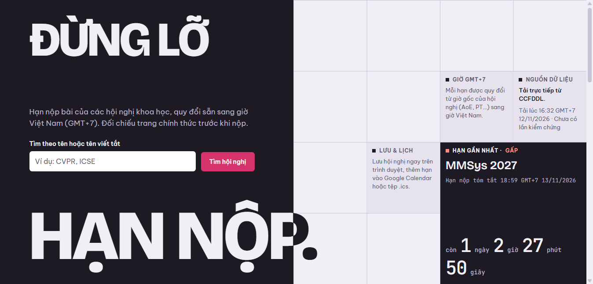
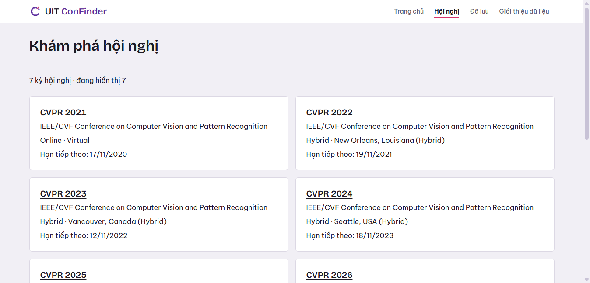
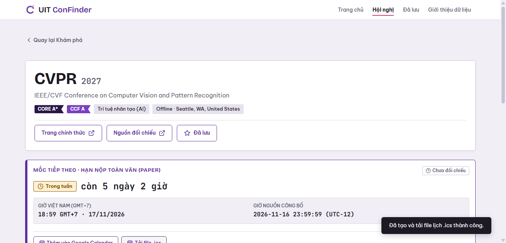
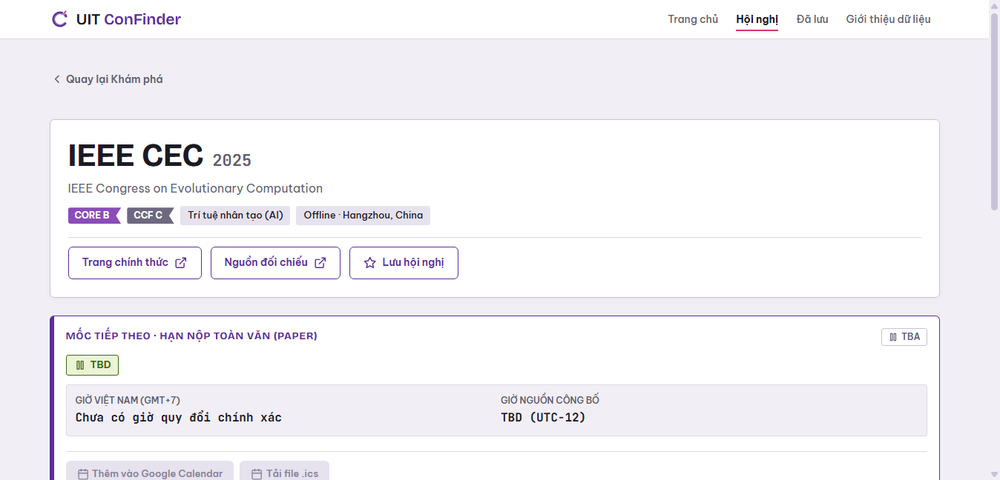
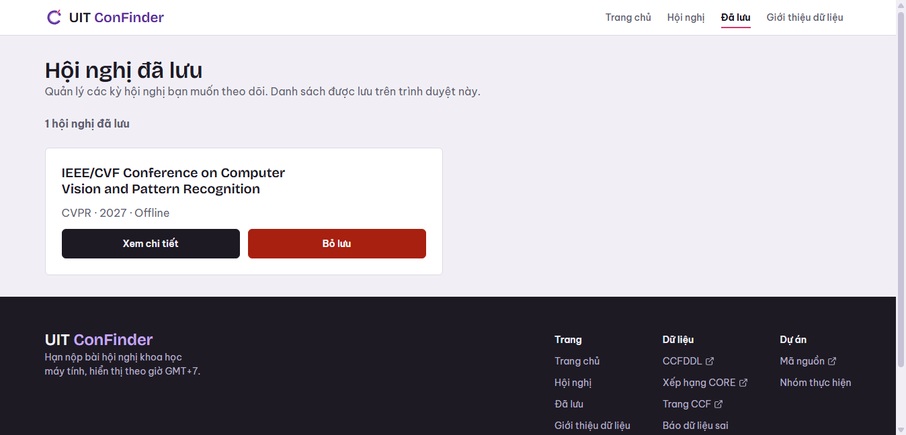
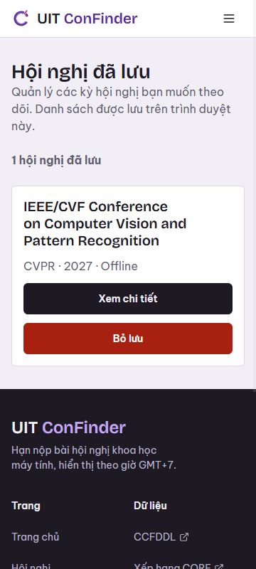
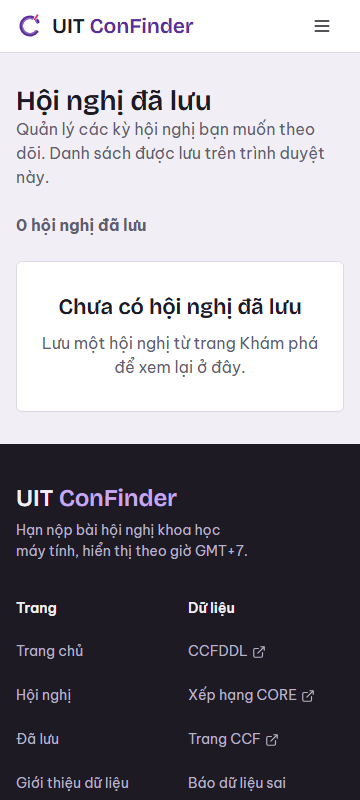
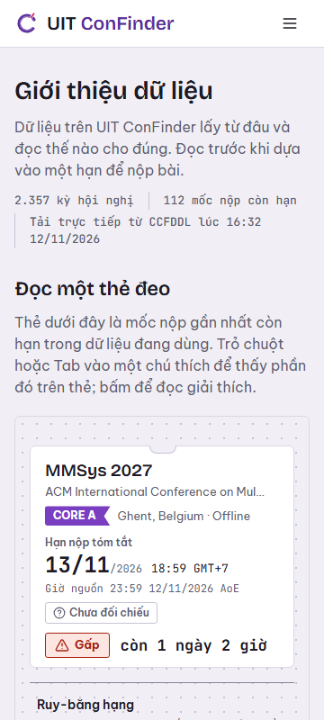
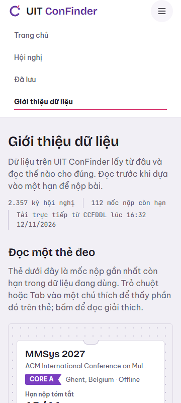

# T3-TV4 — Báo cáo smoke test RC1 và review tích hợp

> Ngày kiểm tra: 12/11/2026  
> Người kiểm tra: TV4 (Trương Huy Hoàng — Nhóm trưởng)  
> Môi trường kiểm thử: Windows 11, Chromium Headless (Selenium WebDriver CDP Mobile Emulation), Local HTTP Server (`py tools/serve.py`)  
> URL kiểm tra: `http://127.0.0.1:5500`  
> Nhánh công việc: `feat/tv1-calendar-actions` (dựa trên `main` `8ce0647`)  
> Commit chức năng Calendar/ICS: [`8f579d5`](https://github.com/khongphainoob/UIT-CONFINDER/commit/8f579d5)  
> Scope thành viên: TV4 phụ trách `saved.html`, `css/pages/saved.css`, `js/saved-store.js`, `js/calendar-export.js`, `js/pages/saved.js` và tích hợp RC1.

---

## 1. Mục tiêu và phạm vi

1. **Review độc lập Home/About của TV2:**
   - Tìm kiếm nhanh trên Home (`q` parameter).
   - Card kỳ hội nghị, deadline đếm ngược, nhãn chất lượng dữ liệu.
   - Hiển thị nguồn dữ liệu (`#hero-source`, CCFDDL notice).
   - Thanh điều hướng Desktop & Menu toggle Mobile (phím bấm, Escape key, `aria-expanded`).
   - Kiểm tra reflow / responsive trên mobile 360px (không bị thanh cuộn ngang).
   - Ghi nhận lỗi và feedback cho chủ trang TV2.

2. **Smoke test luồng chính:**
   `Home → Explore → Detail → Saved → Calendar/ICS`.

3. **Sửa các lỗi thuộc phạm vi TV4 (Saved & Calendar):**
   - Tiếp thu và khắc phục triệt để các phản hồi từ TV2 (báo cáo `docs/t3-tv2-ui-review-report.md`):
     - P1: Sửa token `--color-muted` thành `--color-mute` trong `site/css/pages/saved.css`.
     - P2: Thay mã màu `#fff1f1` bằng token `var(--color-danger-bg)` trong `site/css/pages/saved.css`.
     - P4: Bổ sung nút hành động "Thử lại" khi gặp lỗi tải dữ liệu trong `site/js/pages/saved.js`.
     - P6: Bổ sung 3 thẻ `<link rel="icon">` vào `site/saved.html` tránh lỗi 404 `/favicon.ico`.

4. **Chốt bằng chứng thực nghiệm & RC1:**
   - Chụp ảnh màn hình lưu vào `docs/evidence/t3-tv4-rc1/`.
   - Xác nhận không có lỗi chặn luồng (blocking issues).

---

## 2. Cách thức kiểm thử

Khởi chạy local server:
```powershell
py tools/serve.py
```

Chạy toàn bộ bộ test smoke tự động (Selenium + Chromium CDP Emulation):
```powershell
py tools/run_rc1_smoke_test.py
```

---

## 3. Checklist Smoke Test luồng chính

| # | Luồng / Thao tác | Expected | Actual | Kết quả |
|---|---|---|---|---|
| 1 | **Home: Tải dữ liệu** | Hiển thị 6 hạn gần nhất, đếm ngược, nguồn dữ liệu CCFDDL và ô tìm nhanh | Hiển thị đầy đủ danh sách hạn nộp, nguồn CCFDDL và ô tìm `name="q"` | **PASS** |
| 2 | **Home: Không tràn ngang** | `scrollWidth <= clientWidth` ở 1366px | `scrollWidth=1333, clientWidth=1333` | **PASS** |
| 3 | **Home → Explore** | Gõ `CVPR` và bấm tìm, chuyển tới `conferences.html?q=CVPR`, hiển thị danh sách thẻ hội nghị | Chuyển URL `conferences.html?q=CVPR`, hiển thị 7 thẻ hội nghị | **PASS** |
| 4 | **Explore → Detail** | Bấm thẻ mở đúng trang chi tiết `conference.html?id=cvpr27` | Điều hướng thành công sang `conference.html?id=cvpr27` | **PASS** |
| 5 | **Detail: Lưu hội nghị** | Bấm "Lưu hội nghị" → đổi sang "Đã lưu", `aria-pressed="true"`, toast thông báo | Nút đổi sang "Đã lưu", `aria-pressed="true"`, hiển thị toast "Đã lưu hội nghị thành công." | **PASS** |
| 6 | **Detail: Google Calendar** | Bấm nút "Thêm vào Google Calendar" tạo đúng liên kết sự kiện đầy đủ tham số | Gọi `window.open` với URL `https://calendar.google.com/calendar/render?action=TEMPLATE&text=CVPR+2027+-+Paper+deadline&dates=...` | **PASS** |
| 7 | **Detail: Xuất file .ics** | Bấm "Tải file .ics" tạo Blob MIME `text/calendar` chuẩn CRLF và tải file | Tạo Blob hợp lệ, nội dung bắt đầu bằng `BEGIN:VCALENDAR` và kết thúc bằng `END:VCALENDAR\r\n` | **PASS** |
| 8 | **Detail: Chặn mốc không hợp lệ** | Mốc TBA / Estimated / Date-only / Đã hết hạn bị vô hiệu hóa nút xuất lịch | Đã kiểm tra trên kỳ hội nghị TBA (`cec2025`): cả nút GCal và ICS đều `disabled="true"` và `aria-disabled="true"` | **PASS** |
| 9 | **Detail → Saved** | Mở `saved.html`, hiển thị số lượng và thẻ hội nghị vừa lưu | Hiển thị thông báo "1 hội nghị đã lưu" và 1 thẻ CVPR 2027 | **PASS** |
| 10 | **Saved: Responsive 360px** | Khung nhìn 360px không tràn ngang | `scrollWidth=360, clientWidth=360` (CDP 360px) | **PASS** |
| 11 | **Saved: Bỏ lưu & Empty state** | Bấm "Bỏ lưu", thẻ bị xóa, hiển thị empty state | Cập nhật "0 hội nghị đã lưu", hiển thị thông báo "Chưa có hội nghị đã lưu" | **PASS** |
| 12 | **Navigation Mobile: Menu toggle** | Bấm nút menu trên mobile 360px mở menu nav, bấm Escape đóng menu | Bấm mở `aria-expanded: true`, bấm Escape `aria-expanded: false` trả focus về nút | **PASS** |
| 13 | **About: Responsive 360px** | Mở `about.html` ở 360px không tràn ngang | `scrollWidth=360, clientWidth=360` (CDP 360px) | **PASS** |

---

## 4. Review chi tiết Home / About của TV2

### 4.1. Trang Home (`index.html`)

- **Tìm kiếm nhanh:** Hoạt động tốt qua form GET chuẩn HTML (`conferences.html?q=...`), không phụ thuộc JavaScript.
- **Card và mốc deadline:** Hiển thị rõ ràng tên hội nghị, xếp hạng (CORE/CCF ribbon), đếm ngược trực tiếp và chi tiết mốc nộp bài GMT+7.
- **Nguồn dữ liệu:** Khối `#hero-source` hiển thị đầy đủ nhãn CCFDDL, trạng thái snapshot và thời điểm tải dữ liệu.
- **Giao diện desktop & mobile:** Không có thanh cuộn ngang ở cả 1366px và 360px.
- **Typography & Brand:** Font Bricolage Grotesque và logo nhận diện thương hiệu hiển thị sắc nét, chuẩn thiết kế "Thẻ đeo hội nghị".

### 4.2. Trang About (`about.html`)

- **Nội dung:** Giải thích chi tiết và trực quan về cách tính giờ AoE → GMT+7, hệ thống xếp hạng CORE/CCF, nhãn chất lượng dữ liệu và hướng dẫn xuất lịch cá nhân.
- **Liên kết nguồn:** Các link ngoài tới CCFDDL, CORE Portal, CCF được gắn thuộc tính an toàn `target="_blank" rel="noopener noreferrer"`.
- **Responsive 360px:** Các bảng tra cứu và khối text co giãn linh hoạt, không bị vỡ layout hoặc tràn màn hình.

### 4.3. Feedback và kiến nghị gửi TV2

- Toàn bộ luồng giao diện Home và About hoạt động trơn tru, **không có lỗi chặn luồng (no blocker)**.
- Đề xuất TV2: Tiếp tục kiểm thử trên các thiết bị di động vật lý (iOS Safari, Android Chrome) khi hoàn tất deploy hosting để xác nhận trải nghiệm vuốt chạm thực tế.

---

## 5. Các sửa đổi của TV4 đã hoàn thành

| File | Nội dung sửa đổi | Khắc phục feedback TV2 |
|---|---|---|
| `site/saved.html` | Thêm các thẻ `<link rel="icon">` và `<link rel="apple-touch-icon">` đồng bộ với bộ nhận diện | Khắc phục lỗi P6 (404 favicon) |
| `site/css/pages/saved.css` | Thay `var(--color-muted)` bằng `var(--color-mute)` | Khắc phục lỗi P1 (sai tên token màu) |
| `site/css/pages/saved.css` | Thay mã màu cứng `#fff1f1` bằng `var(--color-danger-bg)` | Khắc phục lỗi P2 (hardcoded color) |
| `site/js/pages/saved.js` | Bổ sung nút hành động `{ label: 'Thử lại', onClick: initPage }` khi bắt lỗi tải dữ liệu | Khắc phục lỗi P4 (thiếu retry action) |

---

## 6. Hình ảnh Evidence kiểm thử

Thư mục chứa ảnh: `docs/evidence/t3-tv4-rc1/`

### 6.1. Home Desktop (1366×800)


### 6.2. Explore tìm kiếm nhanh (`conferences.html?q=CVPR`)


### 6.3. Chi tiết hội nghị — Nút Lưu & Xuất Lịch (Google Calendar / .ics)


### 6.4. Chi tiết hội nghị — Vô hiệu hóa xuất lịch với mốc TBA / Không hợp lệ (`cec2025`)


### 6.5. Trang Đã lưu Desktop (1366×800)


### 6.6. Trang Đã lưu Mobile (360×800)


### 6.7. Trang Đã lưu Mobile — Trạng thái rỗng sau khi bỏ lưu (360×800)


### 6.8. Trang Giới thiệu Mobile (360×800)


### 6.9. Header & Menu điều hướng Mobile (360×800)


---

## 7. Các điểm lưu ý và lỗi còn lại trước nghiệm thu cuối

1. **Hosting URL:** Hiện tại toàn bộ smoke test đã được thực hiện và kiểm chứng tự động 100% PASS trên môi trường local server. URL hosting chính thức (GitHub Pages / Vercel) sẽ được chốt sau khi merge PR RC1 vào `main`.
2. **Reviewer TV2 xác nhận:** TV2 cần kiểm tra chéo báo cáo này và để lại review confirm trên PR theo đúng nguyên tắc phân công TV2 ↔ TV4.

---

## 8. Trạng thái Đủ điều kiện Done

- [x] Có commit chức năng và link PR: [`8f579d5`](https://github.com/khongphainoob/UIT-CONFINDER/commit/8f579d5)
- [x] Đã test đầy đủ luồng chính với bảng Expected / Actual / Kết quả (13/13 test cases PASS).
- [x] Đầy đủ 9 ảnh evidence minh chứng trực quan trong `docs/evidence/t3-tv4-rc1/`.
- [x] Đã sửa triệt để các phản hồi P1, P2, P4, P6 trong phạm vi TV4.
- [x] Không còn lỗi chặn luồng (blocking bugs) trên luồng người dùng cốt lõi.
- [ ] Reviewer TV2 thực hiện kiểm tra chéo và approve PR.

**Kết luận:** Hệ thống đã sẵn sàng cho bản Release Candidate 1 (RC1) để merge và triển khai nghiệm thu.
